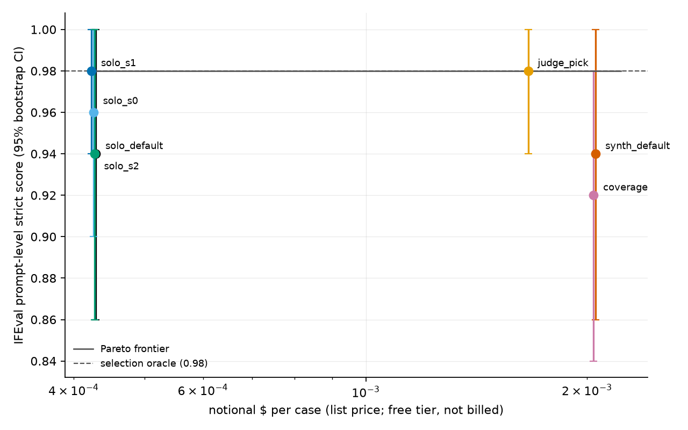
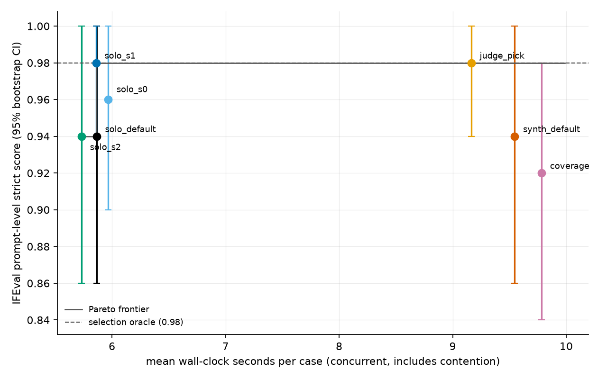
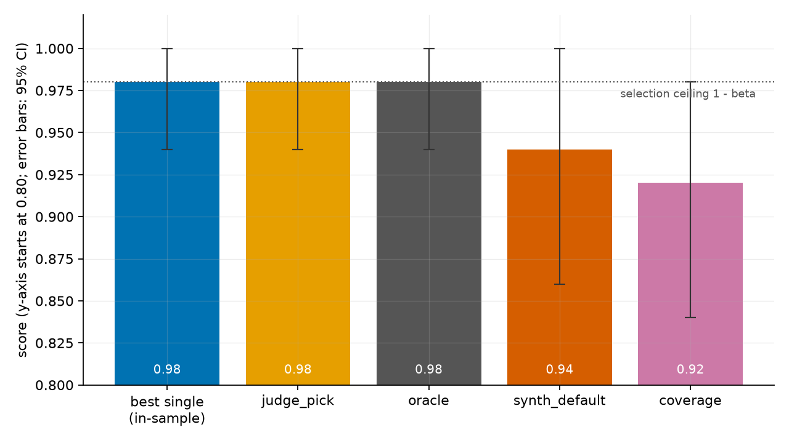

# Selection ceiling vs synthesis surplus on IFEval: a single-model mini pilot

**Summary.** On the first 50 IFEval cases, three independent draws of one model
(`gemini-cli/gemini-3.1-flash-lite`) had a per-case selection oracle of 0.98, equal to the best single draw
(0.98); all three draws failed together on 1 of 50 cases
(beta = 0.02, Clopper-Pearson 95% CI [0.001, 0.106]). Synthesis from those draws did not
exceed the ceiling: Self-MoA-style synthesis scored 0.94
(surplus -0.04, paired 95% CI [-0.10, 0.00])
and the Coverage prompt 0.92
(surplus -0.06, [-0.14, 0.00]). The benchmark is nearly
saturated for this model, so the pilot has little power; the replay shows run-to-run noise of about
0.02 in score, the same size as the differences between candidates.
Real spend was $0 (Google AI Studio free tier); the notional list-price cost of all candidates is
$0.373.

> **This is a single-model pilot, not the originally planned multi-model study.** The planned three-provider
> panel with a frontier synthesizer was not executable (no paid credit on any route). Everything below is the
> Self-MoA regime: sampling diversity from one model.

## 1. The question

Any policy whose output is one of the members' answers (router, vote, cascade, judge-pick) cannot score above the
**per-case selection oracle** `mean_c max_s score[s,c]`; on binary tasks that cap is `1 - beta`, where beta is the
rate at which every member fails the same case (Chen 2026, arXiv:2606.27288). A **synthesizer** writes a new answer
and is not bound by it. **Synthesis surplus = synthesis score - selection-oracle score.** A positive surplus is gain
no router or cascade could reach. The Self-MoA baseline aggregates several samples of one model (Li et al.,
arXiv:2502.00674), which is exactly the regime measured here.

## 2. Setup

| | |
|---|---|
| Model | `gemini-cli/gemini-3.1-flash-lite` (the only route usable with a free Gemini AI Studio key) |
| Panel | 3 draws, `temperature=0.7`, byte-identical requests (`seed` is disabled on this route) |
| Benchmark | `ifeval`, Engine revision `1cba769ece27f7ef`, deterministic official verifier |
| Cases | first 50 in dataset order (`limit=50`; not a random sample), excluded: 0 |
| Toolkit | `screamingface` 0.1.3, Python 3.12.6, Windows-11-10.0.26300-SP0 |
| Date | 2026-10-15 (single sitting) |
| Spend | $0 billed (free tier); notional $0.373 at $0.25 / $1.50 per 1M input / output tokens |

The hypotheses, metrics, n and exclusion rules were written down before the main run; that planning document is not
part of this repository, so treat the design as author-declared rather than independently verifiable.

### Deviations from the originally planned study

- **One model instead of three providers plus a frontier synthesizer.** The OpenRouter key had no credit; Hugging Face
  credits were exhausted; Gemini 2.5 routes are closed to new keys; Groq routes are not served by the Engine.
  Only `gemini-3.1-flash-lite` was usable. The frontier-vs-cheap synthesizer contrast, mixed-model panels, matched-cost
  Self-MoA and the second (rubric-graded) benchmark were therefore not run.
- **No `seed`.** The route disables it, so panel draws are three identical `temperature=0.7` requests and sampling is
  unseeded; replay can only check statistical consistency.
- **No per-case token or latency data.** The free-tier gateway attributes no per-call usage; only run-level totals exist.
- **Windows workaround.** `screamingface` 0.1.3 calls `os.fsync` on a read-only file, which fails on Windows after the
  model calls finish; `src/winpatch.py` skips that call (durability only).
- **Cases are the first 50 in dataset order**, because the benchmark defines `slice=0:541` and `limit=n` takes a prefix.

## 3. Results (n = 50)

| candidate | score [95% CI] | tokens in / out per case | notional $ per 1000 cases | wall s per case | recipe |
|---|---|---|---|---|---|
| `solo_default` | 0.94 [0.86, 1.00] | 59 / 276 | 0.43 | 5.9 | [`results/url4/solo_default.txt`](results/url4/solo_default.txt) |
| `solo_s0` | 0.96 [0.90, 1.00] | 59 / 274 | 0.43 | 6.0 | [`results/url4/solo_s0.txt`](results/url4/solo_s0.txt) |
| `solo_s1` | 0.98 [0.94, 1.00] | 59 / 272 | 0.42 | 5.9 | [`results/url4/solo_s1.txt`](results/url4/solo_s1.txt) |
| `solo_s2` | 0.94 [0.86, 1.00] | 59 / 275 | 0.43 | 5.7 | [`results/url4/solo_s2.txt`](results/url4/solo_s2.txt) |
| `judge_pick` | 0.98 [0.94, 1.00] | 1681 / 829 | 1.66 | 9.2 | [`results/url4/judge_pick.txt`](results/url4/judge_pick.txt) |
| `synth_default` | 0.94 [0.86, 1.00] | 1551 / 1112 | 2.06 | 9.5 | [`results/url4/synth_default.txt`](results/url4/synth_default.txt) |
| `coverage` | 0.92 [0.84, 0.98] | 1612 / 1093 | 2.04 | 9.8 | [`results/url4/coverage.txt`](results/url4/coverage.txt) |

CIs are bootstrap percentile intervals (10,000 resamples over cases, fixed seed). Notional $ is a list-price estimate
from run-level token totals, not an invoice. Wall-clock per case is the run duration divided by cases; the seven
candidates ran concurrently on one free-tier key, so it includes contention and is not a clean per-candidate latency.
Per-case token and latency figures and fusion critical-path latency are not available (the free-tier gateway attributes
no per-call usage). Median and p95 latency are therefore not reported.

## 4. Decomposition

| quantity | value |
|---|---|
| best single draw (in-sample: `solo_s1`) | 0.98 |
| `judge_pick` (realizable selection) | 0.98 |
| selection oracle | 0.98 [0.94, 1.00] |
| oracle gain over best single | +0.00 |
| beta (all 3 draws fail, score < 1.0) | 0.02 (1/50), CP 95% [0.001, 0.106] |
| selection ceiling 1 - beta | 0.98, CP 95% [0.894, 0.999] |
| $0 certificate: max gain of any selection policy over best single | 0.019 |

| synthesis candidate | score | surplus vs oracle [paired 95% CI] | rescue | damage |
|---|---|---|---|---|
| `synth_default` (Self-MoA) | 0.94 | -0.04 [-0.10, 0.00] | 0 | 2 |
| `coverage` | 0.92 | -0.06 [-0.14, 0.00] | 0 | 3 |

Rescue = all three draws failed but synthesis passed (beyond the ceiling). Damage = at least one draw passed but synthesis
failed. Case IDs: [`results/tables/rescue_damage.csv`](results/tables/rescue_damage.csv).

Instruction level (strict): best single 0.987, union oracle
0.987. Synthesis efficiency is not available because union - best single is 0.

Paired comparisons (exploratory, many comparisons on a small n, no multiplicity correction; exact McNemar):

| comparison | mean difference [paired 95% CI] | McNemar p (only-first / only-second) |
|---|---|---|
| `synth_default` vs `solo_default` | +0.00 [-0.08, 0.08] | 1.00 (2 / 2) |
| `synth_default` vs best single (`solo_s1`, in-sample) | -0.04 [-0.10, 0.00] | 0.50 (0 / 2) |
| `coverage` vs `synth_default` | -0.02 [-0.10, 0.04] | 1.00 (1 / 2) |

### Pre-registered hypotheses

- **H1** (surplus about 0 or negative on IFEval): consistent. Both synthesis surpluses are at or below 0, with upper CI
  bounds at 0.00; no case was rescued.
- **H2** (judge-pick recovers only part of the oracle gain): not informative. The oracle gain over the best single draw is
  +0.00, so there was nothing to recover; `judge_pick` equals the oracle (0.98).
- **H3** (`coverage` >= `synth_default`): not supported. The observed difference is -0.02 [-0.10, 0.04], the interval includes 0.
- H4 and H5 (mixed-model vs Self-MoA, rubric benchmark) were dropped at pre-registration and are not tested.

## 5. Figures





## 6. What this does and does not show

- **One model, sampling diversity only.** The panel is three draws of the same model, so it cannot test mixed-model panels,
  the frontier-vs-cheap synthesizer lever, or matched-cost Self-MoA vs mixed fusion. Those remain open.
- **Saturated benchmark.** The draws score 0.98 or less on 50 cases; beta is about
  0.02 with a wide interval [0.001, 0.106]. There is almost no headroom for synthesis surplus to appear,
  so a null here says little about harder or open-ended tasks. IFEval is verifiable, so the ceiling is expected to bind.
- **Small n, one sitting, first 50 cases only** (dataset order, not random). All comparisons are exploratory.
- **Noise is as large as the effects.** Replaying the same recipes (unseeded sampling) moved scores by up to
  0.02, the size of the synthesis-vs-solo gaps above. Do not read ranking among candidates
  from this pilot.

| candidate | main | replay | per-case agreement |
|---|---|---|---|
| `coverage` | 0.92 | 0.94 | 0.98 |
| `judge_pick` | 0.98 | 0.98 | 1.00 |
| `solo_default` | 0.94 | 0.96 | 0.94 |
| `solo_s0` | 0.96 | 0.96 | 1.00 |
| `solo_s1` | 0.98 | 0.96 | 0.98 |
| `solo_s2` | 0.94 | 0.96 | 0.98 |
| `synth_default` | 0.94 | 0.96 | 0.94 |

- **In-sample best single** biases the oracle gain downward and flatters selection baselines.
- **Separate runs.** Each candidate is its own run; fusion members are fresh draws, not the outputs of the `solo_s*` runs.
- **Provider latency is not wall-clock;** per-call latency was not available, and wall-clock includes concurrent contention.
- **Prices:** notional, Google list price as retrieved on the run date (verify before quoting).
- **Free tier:** Google may use free-tier prompts for product improvement (IFEval prompts are public).

## 7. Reproduce

Windows, Python 3.12 (`make` and Docker were unavailable here, so no working Makefile run and no Dockerfile).

```
uv venv --python 3.12
uv pip install --python .venv/Scripts/python.exe -r requirements.lock
.venv/Scripts/screamingface.exe prepare ifeval
.venv/Scripts/screamingface.exe up
.venv/Scripts/python.exe -m src.connect_key --provider gemini-cli   # hidden prompt for the key
.venv/Scripts/python.exe -m src.run_all --stage smoke
.venv/Scripts/python.exe -m src.run_all --stage probe
.venv/Scripts/python.exe -m src.run_all --stage main
.venv/Scripts/python.exe -m src.run_all --stage analyze   # deterministic; regenerates summary.json byte for byte
.venv/Scripts/python.exe -m src.run_all --stage replay    # re-samples; reports consistency, not equality
.venv/Scripts/python.exe -m src.readme                    # regenerate this README from results/summary.json
.venv/Scripts/python.exe -m unittest tests.test_analyze -v
```

`analyze` reads only `results/raw/ifeval_main.json` (sha256 recorded in `results/summary.json`). Windows needs the
`src/winpatch.py` workaround for an `os.fsync` bug in `screamingface` 0.1.3 (see Deviations); it is applied
automatically by `src.run` and `src.replay`. Replay cost: $0 (free tier; measured, see `results/cost_ledger.csv`).

## 8. Next steps

Rubric-graded benchmarks (DRACO, HealthBench) where headroom exists; a synthesizer-tier sweep and mixed-provider panels
with paid credit; matched-cost Self-MoA; more sittings and larger n with seeded sampling on a route that supports `seed`.

## 9. Citation / author

[Your Name], [contact]. Cite: Chen 2026, arXiv:2606.27288 (selection ceiling); Li et al., arXiv:2502.00674 (Self-MoA).
